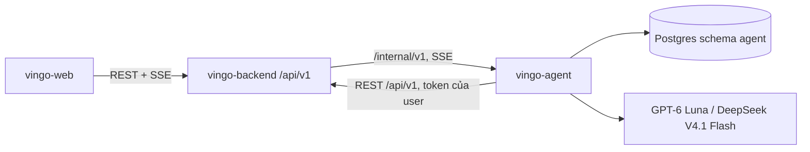

# vingo-agent

Trợ lý chat của Vingo: giúp người mua tìm sự kiện, giữ vé, thanh toán, xem vé; giúp admin tra cứu số liệu và tạo/công bố sự kiện.

> **Trạng thái: khung.** App chạy được, auth và validate request đã có, các route nghiệp vụ trả `501`. Tool, guardrail và luồng thực thi còn là stub (`NotImplementedError`).

Thiết kế đầy đủ: [docs/VINGO_AGENT_DESIGN_V2.3.md](docs/VINGO_AGENT_DESIGN_V2.3.md).

## Kiến trúc



- **Dịch vụ nội bộ.** Chỉ module `chat` của vingo-backend gọi vào. Web không gọi trực tiếp.
- **Backend là nguồn sự thật.** Agent đọc và ghi nghiệp vụ qua REST `/api/v1` bằng session token của user, nên backend kiểm quyền mọi lần gọi.
- **Model không ghi nghiệp vụ.** Tool ghi chỉ tạo *đề xuất*. User xác nhận bằng nút trên thẻ hoặc nhắn đồng ý thì code thực thi đúng payload đã lưu, không qua model.
- **Lưu trữ riêng.** Hội thoại, đề xuất, lịch sử thực thi và file SVG tạm nằm ở schema Postgres `agent`.
- **Model dự phòng.** GPT-6 Luna lỗi (timeout, 5xx, 429) trước khi trả chữ thì tự chuyển sang DeepSeek V4.1 Flash.

## Yêu cầu

- Python 3.12 và [uv](https://docs.astral.sh/uv/)
- PostgreSQL 18 (dùng `uuidv7()`): dùng chung Postgres của vingo-backend (`deploy/compose.dev.yaml`)
- Docker (chỉ để chạy test integration)
- vingo-backend chạy ở `localhost:8080`, repo nằm cạnh repo này (`../vingo-backend`)

## Chạy local

1. Cài dependency và tạo file môi trường:

   ```bash
   uv sync
   cp .env.example .env
   ```

   Điền vào `.env`:

   | Biến | Ý nghĩa |
   |---|---|
   | `AGENT_SERVICE_KEY` | Khoá backend dùng khi gọi agent (header `X-Agent-Service-Key`); phải giống cấu hình backend |
   | `AGENT_TO_BACKEND_KEY` | Khoá agent gửi lên backend (header `X-Vingo-Agent-Key`), để backend ghi `via_agent` |
   | `OPENAI_API_KEY` | Key cho model chính `openai:gpt-6-luna` |
   | `DEEPSEEK_API_KEY` | Key cho model dự phòng `deepseek:deepseek-flash`; để trống thì chỉ dùng model chính |
   | `DATABASE_URL` | Mặc định trỏ Postgres local, role `vingo_agent` |
   | `AGENT_ADMIN_WORKFLOWS_ENABLED` | Bật KAN-203 khi backend có endpoint visibility và web chạy Copilot V2.3 |

   Các biến còn lại (giới hạn turn, kill switch `AGENT_DISABLED_TOOLS`) có giá trị mặc định, xem `.env.example`.

2. Tạo role `vingo_agent` trên Postgres của backend (một lần), chạy bằng tài khoản chủ DB:

   ```sql
   CREATE ROLE vingo_agent LOGIN PASSWORD 'vingo_agent';
   CREATE SCHEMA IF NOT EXISTS agent AUTHORIZATION vingo_agent;
   REVOKE ALL ON SCHEMA public FROM vingo_agent;
   ```

   Role này chỉ có quyền trên schema `agent`.

3. Chạy migration và khởi động:

   ```bash
   uv run alembic upgrade head
   uv run uvicorn vingo_agent.api.app:app --host 127.0.0.1 --port 8000
   ```

   Kiểm tra: `curl localhost:8000/health` trả `{"status":"ok"}`.

## API nội bộ

Mọi route dưới `/internal/v1` yêu cầu header `X-Agent-Service-Key`, `X-Vingo-User-Id`, `X-Vingo-Role` và `Authorization: Bearer <session token>`, đều do backend gắn.

| Route | Việc |
|---|---|
| `POST /conversations` | Tạo hội thoại |
| `GET /conversations/{id}` | Lịch sử và đề xuất đang chờ |
| `POST /conversations/{id}/messages` | Gửi tin, nhận SSE |
| `POST /uploads` | Admin tải một SVG tối đa 10 MiB, nhận `upload_id` có hiệu lực một giờ |
| `POST /actions/{id}/confirm` | Xác nhận bằng nút, nhận SSE |
| `POST /actions/{id}/reject` | Từ chối đề xuất |
| `GET /turns/{id}` | Lấy lại kết quả turn khi SSE đứt |

Body, sự kiện SSE và payload block: thiết kế mục 3.3 và 7.1, kiểu Python ở `src/vingo_agent/schemas/`.

## Kiểm tra

```bash
uv run ruff check . && uv run ruff format --check .
uv run pytest tests/unit
uv run pytest tests/integration          # cần Docker, kéo image postgres:18 lần đầu
uv run python scripts/sync_contract.py   # 30 operationId agent dùng khớp ../vingo-backend/contracts/vingo-openapi.yaml
```

CI (`.github/workflows/ci.yml`) chạy đủ các bước trên cho mỗi PR, check tên `verify`; CodeQL quét Python và workflow. `main` và `develop` chỉ nhận thay đổi qua PR có các check này xanh.

## Cấu trúc

Cây thư mục và trách nhiệm từng file: thiết kế mục 10.

| Thư mục | Trách nhiệm |
|---|---|
| `src/vingo_agent/api/` | Route, auth từ backend, sự kiện SSE |
| `src/vingo_agent/agents/` | Tool theo role, dựng agent (model chính + dự phòng), chạy turn |
| `src/vingo_agent/tools/` | 52 tool (đọc, đề xuất, quyết định), lọc kết quả, dựng block |
| `src/vingo_agent/actions/` | Đề xuất, xác nhận, thực thi, tra khi không rõ kết quả |
| `src/vingo_agent/guardrails/` | Kiểm input, tool, kết quả, câu trả lời, giới hạn |
| `src/vingo_agent/context/` | Dựng context, compact |
| `src/vingo_agent/clients/` | Gọi backend |
| `src/vingo_agent/persistence/` | Schema `agent` |
| `migrations/` | Alembic |
| `evals/` | Seed và 80 case đánh giá (thiết kế mục 8) |

## Đóng góp

Quy tắc code, bất biến an toàn và checklist thêm tool: [CLAUDE.md](CLAUDE.md). Commit message viết tiếng Việt.

Chạy Phoenix local: `docker compose -f compose.dev.yaml up -d`.
Đặt `OTEL_EXPORTER_ENDPOINT=http://localhost:6006` trong `.env` rồi khởi động agent.
Mở http://localhost:6006 để xem trace.
Muốn xem cả tin nhắn và tham số tool khi debug prompt: đặt thêm `OTEL_INCLUDE_CONTENT=true` (chỉ có hiệu lực với endpoint localhost).
